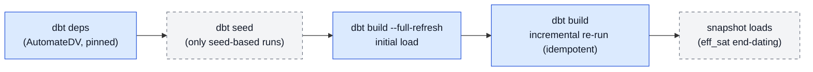

# 9. From output to warehouse

## 9.1 The generated project

A finalized run's output directory *is* a dbt project: models (staging + raw vault),
`dbt_project.yml` (staging as views, raw vault incremental, seeds unquoted),
`packages.yml` (AutomateDV, pinned), and a generated `README.md` documenting how to run
exactly this output. You supply two things: the **raw data** — either as dbt seeds
(CSVs matching the expected columns documented in `models/staging/sources.yml`) or as
real tables when the run was grounded with physical locations — and a
**`profiles.yml`** with your warehouse connection.

## 9.2 Build workflow

`dbt build --full-refresh` is the canonical first command: it seeds (where
applicable), builds staging and raw vault, and runs the generated tests in one pass.
The acceptance signal that matters operationally is the **incremental re-run**: a
second plain `dbt build` must be idempotent — no duplicate rows, no changed end-dates.
If a re-run changes row counts, something is wrong (usually staging binding or key
hashing), regardless of how green the first build was. PASS counts vary with the
model; the demos' READMEs record their expected values as dated reference points.

## 9.3 Source binding forms

How a staging model references its raw relation tells you how much the run knew about
your sources — recognisable in `models/staging/*.sql` and `sources.yml`:

**Inferred** (`raw_<base>`): no declared source table matched, so the generator named
the conventional relation and flagged it (`SOURCE_BINDING`, advisory; `BINDING_REJECTED`, a
decision, when WP73 refused a relation lacking a hashed column). Seed-based builds use this
form as a bare name; the flag is your review prompt, never a silent guess. **In a project that
addresses its declared inputs through `source()` blocks, every inferred relation is declared
under one more block, `inferred`, with `schema: "{{ target.schema }}"` (WP76, 2026-10-17)** —
AutomateDV turns a bare name into a `ref()`, and one unresolvable `ref()` had made a whole
chain project unparseable. The project now parses; a build fails exactly on the inferred
stages until you provide each relation as a table or view of that name in the target schema
(or a seed, which lands there too).

**Declared, bare-name**: a grounded run matched a declared table *without*
schema/database — the staging references the table name directly and `sources.yml`
documents the expected raw interface. This deliberately keeps the seed-compatible
pattern (a dbt source without a schema property would default its schema to the
source name and break it).

**`source()` mapping form**: the declared table carried `schema`/`database`, so
staging binds via dbt's `source()` and `sources.yml` becomes a real source definition
(one block per distinct database/schema). No seeds involved — dbt reads your actual
raw tables. Ratifying mappings at the checkpoint (7.6) upgrades bindings to this form
and clears the inferred-binding flags.

**Carried binding** (WP77, 2026-10-17): a brownfield run keeps the declared binding an earlier
increment made for a stage — `stage_bindings` in `metadata/source_catalogue.yml`, keyed by stage
model — when its own resolution (a ratified mapping, a ratified proposal, the offer) says nothing
about that stage; WP73's column check still applies and a refused carried binding is a
`binding_rejected` decision. Before WP77 a link bound by offer in one step inferred in the next,
because the offer tier sees only the increment's tables (the twentieth chain lost 24 of 34).

**Translation model** (WP36, ADR-0013): a link ratified from a foreign key that references a
surrogate while the hub is keyed on the natural key gets a second staging model,
`stg_<link>_via_<relation>` — a view that LEFT JOINs the referencing relation to the
referenced one on the surrogate and projects the natural key under the hub's canonical
column name. The link's ordinary `stage` model reads that view instead of the raw relation;
its hashes are unchanged. Every row of the referencing relation survives the join; an
unmatched surrogate becomes a NULL key that the model's own `schema.yml` refuses at
`dbt build` (`not_null` on the projected key, `relationships` from the surrogate to the
referenced relation). The translation is therefore visible SQL and a failing test, never a
hidden mapping. When the referencing relation carries a column of the natural key's name that
means something else (`SalesOrderHeader.AccountNumber`, a financial account), the key is projected
as `<KEY>_VIA_<RELATION>` (`ACCOUNTNUMBER_VIA_CUSTOMER`) and the relation's own column stays payload
(WP89, 2026-10-23). `metadata/automatedv.yml` records it under the link's staging entry as
`key_translation`, one entry per join. Since WP39 the join may go one table further than the relation the foreign key names — when that relation has no hub and its key is itself a declared foreign key — and the view is still one LEFT JOIN, to the end table. **Built on PostgreSQL since 2026-09-13** (`demo/fk_links_postgres`); that first build fixed the view's `schema.yml` (not valid YAML before) and the case of two translations in one link (one view, one LEFT JOIN each, `_via_<a>_and_<b>`).

**Relationship-table link** (WP37): a link ratified for a whole table (`Table.*`, 7.5) is
named `link_<table>` and its stage binds to *that* table — the one relation that carries every
participation's key — through the same override path a ratified mapping uses, so no
`SOURCE_BINDING` flag is raised for it. Translated participations read their translation
views as above. Built on PostgreSQL in the same demo since 2026-09-13.

**Link bound by its offer** (WP42): a link the modeler named freely — `link_bom` from
`BillOfMaterials` — matches no table by name. When exactly one declared relation offers all its
participations (`rules.resolve_link_relation`, reason `offer`; see `E_LINK_KEY_WRONG_COLUMN` in
chapter 8), its stage binds to that relation through the same override path, so no
`SOURCE_BINDING` flag is raised. An ambiguous or unbindable link keeps the inferred `raw_<base>`
and its flag, which since WP47 carries the typed reason: `ambiguous` (two or more relations offer
the participations — a review decision), `none` (nothing declares the relation), `shared` (the
stage is a hub's). A chain step that receives the catalogue of the steps before it (the
`adventureworks_incremental_cumulative` eval case) binds most of what the per-domain chain can
only infer. Like the name rule, it applies on every run, to the links of a vault being extended
as well — staging is re-derived each time, so a brownfield run over the same vault and schema
stages them as the run that built them did. One case keeps its binding on purpose: a link whose
stage a hub shares by name (`link_vendor_business_entity` beside `hub_vendor_business_entity`),
where the hub's binding decides. Built on PostgreSQL in the same
demo since 2026-09-17.

**Link bound by evidence** (WP90, 2026-10-23): when two or more relations offer a link's
participations, the catalogue may still single one out — first the relation that declares
**every** attribute of the link's satellites (reason `payload`; a generic column such as
`ModifiedDate` decides nothing), else the one whose primary key the participations cover (reason
`key`; a single-source hub of the link built from the relation covers it whole —
`Customer.CustomerID` for `hub_customer` keyed on `AccountNumber`). The pick is declined when it
lacks a column a participation names explicitly, because staging would refuse it. The stage binds
through the override path like an offer, and every such binding is a `link_binding_evidence`
review decision naming the chosen relation and its rivals — in place of the `ambiguous` decision.
Measured on the owner's Sales vault: four of the five links bound by hand bind exactly to the
hand views' relations, built PASS=407 without those four views.

**Subtype feed** (WP38): a satellite on a hub keyed on the natural key, read from a table keyed
on the supertype's surrogate — `sat_sales_person_details` on `hub_employee` from `SalesPerson` —
has its dedicated stage read `stg_<satellite>_via_<relation>`: the same translation view and the
same data-time tests. It arises only from a ratified same-as whose join the schema declares
(7.5). Since WP39 also a table keyed on the subtype's key (`SalesPersonQuotaHistory`). Built on
PostgreSQL since 2026-09-14 (`demo/fk_links_postgres`).

**Key-license repair** (WP40): a link or satellite the modeler built from a relation that lacks a
participation's key gets that participation's translation, or alias, from a ratified key license
or link proposal. The link's stage and a link satellite's stage then read one view with one LEFT
JOIN per translated participation (`stg_product_inventory_via_product_and_location`). Nothing is
built that the modeler did not build. Built on PostgreSQL since 2026-09-15.

**Role columns** (WP41): a role-qualified participation stops demanding `ROLE_<key>` from its
relation once a ratified key pairs with it. A same-named key is derived into the role column
(`ORGANISATION_BUSINESSENTITYID` from `BUSINESSENTITYID`), a renamed key the same way
(`BUSINESSENTITYID` from `PERSONID`), and a translation projects under the role column
(`r1.PRODUCTNUMBER as ASSEMBLY_PRODUCTNUMBER`), so two roles of one hub through one table stay two
columns with their own `not_null` tests. AutomateDV computes derived columns together from the source
row, so both derivations read source values. Link satellites read from their own table get the same,
per participation. Built on PostgreSQL since 2026-09-15 (`demo/fk_links_postgres`, `PASS=103`).

**Reserved-word columns** (WP79, 2026-10-18): a source column named like a reserved word —
`SalesTerritory.Group`, `ProductProductPhoto.Primary` — is escaped in the stage through
AutomateDV's own mechanism (a derived column `GROUP_` with `source_column: 'group'` and
`escape: true`, the physical spelling the platform folds to: lower on PostgreSQL, upper on
Snowflake, as declared on Databricks), and every raw-vault reference names the alias `GROUP_`.
The list is PostgreSQL's 101 reserved keywords (`rules.RESERVED_COLUMN_WORDS`, from
`pg_get_keywords()`), the strictest of the platforms; a project without such columns renders as
before. Before WP79 the same project built on Databricks and failed on PostgreSQL with `syntax
error at or near "group"` — six views and their sixteen dependants on the twenty-first chain.

## 9.4 Incremental behaviour & effectivity end-dating

The generated effectivity satellite closes superseded relationships: AutomateDV's
auto-end-dating is enabled, driven by a dedicated `APPLIED_DTS` column that staging
derives from the business start date — so a superseded row is closed to the
*successor's business date*, not to a load timestamp. The bank demo's Phase B2 shows
the canonical two-batch pattern: after loading a transfer snapshot, the account's
first ownership row is end-dated to the new owner's start (2026-04-01) and the new row
stays open — and stays that way on re-runs.

Multi-active satellites read their own finer-grained staging (their declared
`source_table`), with the parent's hash key joining every row back to the hub.
Multi-source hubs union their per-source staging models into one hub — the same key
value produces an *identical* hash key in every feed's stage and in the hub, which is
the property to spot-check after a first multi-source build (one row per key,
satellites split by record source).

A hub with a **composite key** (WP45, `business_key_columns`) hashes every key column, in
the declared order, into one hash key — AutomateDV's list form of `hashed_columns` — and its
`src_nk` is the same list; satellites on it and links it takes part in hash the same list from
their own relations. Spot-check after a first build: one hub row per distinct column tuple,
every satellite and link row joining it (`demo/fk_links_postgres`, `hub_currency_rate`).

A **composite foreign key** (WP46) is read per component, one table further: when the
referenced table declares a single-column key on a component onward (`SalesOrderDetail.
(SpecialOfferID, ProductID) → SpecialOfferProduct`, whose `ProductID → Product`), the component
is a key into that table and licenses the same translations a declared single key would —
the line satellite reaches `hub_product`'s natural key through `Product`. A component with no
onward key stays a typed `composite_key` skip naming it (`demo/fk_links_postgres`,
`link_sales_order_line`).

## 9.5 The demos as reference runs

All three demos build a real Postgres vault **without an API key** (deterministic build
scripts through the real code generator) and serve as regression anchors — re-run them
after any upgrade (AutomateDV bump, dbt bump, generator change):

`demo/bank_postgres/` — the ungrounded baseline: seed-based, inferred bindings,
hand-authored staging for the two-phase end-dating demo, self-referencing transfer
link with role-qualified FKs. Its README's runbook and Findings section double as a
worked example of everything in 9.2–9.4.

`demo/bank_databricks/` — the bank demo's twin on Databricks (WP72): same SQL, seeds and
tests, seed types in the Databricks dialect, connection from the environment, its own
`.venv-databricks`. Its README has the runbook; the recorded build is in `docs/log.md` 2026-10-16.

`demo/mapping_postgres/` — the grounded contrast: declared enriched schema plus a
ratified mapping, staging bound to real business-named tables, **zero**
inferred-binding flags. Same model, different knowledge — comparing the two staging
layers side by side is the fastest way to internalise 9.3.

`demo/fk_links_postgres/` — the FK-derived links: a surrogate→natural-key translation
(WP36, ADR-0013) and a three-way relationship-table link with two translated
participations (WP37), proposed from declared foreign keys, ratified, applied and
generated by the pipeline's own functions. Its translation views carry the `not_null` /
`relationships` tests that are the data-time gate; its README shows the gate failing on
an orphan surrogate.

## 9.6 Platform notes

The vault SQL is platform-neutral: every physical difference is AutomateDV's, dispatched
per adapter inside the package. What the generator itself knows per platform is the seed
column types it writes when a contract pins a staging source's types (WP7), and the
profile hint in the generated README. That knowledge lives in one place,
`rules/platforms.py`; `--target-platform` (6.2) selects it, and the choice is persisted
with the run so a resume keeps it.

**PostgreSQL** — the default, and the first platform **verified end-to-end** including the
output of real runs (Databricks followed in WP72, below) (PostgreSQL 16, pinned AutomateDV, the demos in 9.5). The convention worth knowing is casing — every
identifier stays *unquoted* (seeds set `quote_columns: false`), so UPPER_SNAKE names fold
consistently.

**Databricks** — selectable since WP35 (2026-09-11); **verified on the bank demo since
2026-10-16** (WP72 stage 1: `demo/bank_databricks/` on a Free Edition serverless warehouse,
dbt-databricks 1.12.5, `PASS=36`, idempotent, end-dating closes, `BALANCE` intact) **and for a
real run's output since the same day** (WP72 stage 2: the person step generated with
`--target-platform databricks`, the 13 AdventureWorks tables in `workspace.person`, `PASS=48`,
every hub equal to its source's distinct keys — `docs/log.md` 2026-10-16); **the five-step
chain's increments are built there too** (WP72 stage 3, the same day: 37 of 39 hubs, 32 of 51
links, 92 of 96 satellites across the 68 AdventureWorks tables — nothing failed for a platform
reason; what did not build is 13 mis-bound staging views and 10 ungrounded ones, the
generator's, see the log). A generated `sources.yml`'s `schema:` resolves under the profile's
`catalog:` with no mapping. **Two things to know before building a chain's output anywhere:** an
output written before WP74 (2026-10-17) declares only its own increment's sources and re-renders
the earlier constructs' staging ungrounded — build each step's new models there, or regenerate
once; from WP74 on the source catalogue travels with the model and the project parses whole
(`project_self_contained` in the eval). And the Free Edition's Unity Catalog quotas: **100 tables per
schema and 500 per metastore, views counted as tables, enforced on an estimate** (the per-schema
limit let `vault_aw` reach 276 objects before it struck; Databricks mails at 85 % and 100 %). A whole
AdventureWorks vault with its staging views exceeds the per-schema quota on its own — split staging
and raw vault into two target schemas there (`+schema:` per model path in `dbt_project.yml`), and drop
earlier builds before a new one (`docs/log.md` 2026-10-17) — **always, before every build:** the quota counts
replacing a view as creating one, so a `--full-refresh` into a schema already above the limit fails whole
(142 refusals, PASS=0, 2026-10-17); staging alone needs two schemas (145 views). **Dropping does not free
the metastore quota:** dropped tables and views stay counted for their seven-day UNDROP retention, and
every `CREATE OR REPLACE VIEW` leaves a dropped copy (`SHOW TABLES DROPPED IN <schema>` shows them), so
the 500 is a budget of creations per week — one whole AdventureWorks vault (340 objects) beside the 83
source and demo objects; a second build in the same week is refused with „estimated count: 754“ while
`information_schema` counts 83 (2026-10-18). Probe with one `CREATE TABLE` first. dbt-databricks without a `unique_key` merges `on FALSE`, i.e. appends,
so no incremental-strategy setting is generated. Selecting it changes two things — seed types use the native spellings
(`string` instead of `varchar`, which needs a length there; `decimal(38,18)` instead of
`numeric`, whose platform default `DECIMAL(10,0)` would silently truncate fractions) and
the README names the adapter (`dbt-databricks`, `uv sync --extra demo-databricks`) and
the profile shape. Every macro the generated project calls has a Databricks implementation
in the pinned AutomateDV, checked by a test that reads the installed package. On the first
build there, run the demo checklist (build green, incremental idempotent, end-dating
closes) and two Databricks-specific checks: that a plain `dbt build` appends rather than
merges (dbt-databricks defaults to `merge`; without a `unique_key` it should insert every
row — unverified), and that a `number` column loads with its fractions intact, which is
the defect this dialect exists to prevent. The spec's §6 lists the open questions:
`backlog-2026-07/wp35-target-platform-databricks-spec.md`.

**Snowflake, BigQuery, MS SQL Server** — supported by the AutomateDV backend, no profile of
their own yet: they run under the default platform, i.e. with Postgres-spelled seed types,
which those platforms accept. Not covered by the project's own verification; treat the
demo checklist as the acceptance test and expect platform-specific casing/quoting to be
the first thing to check. A profile is added when someone verifies one.
